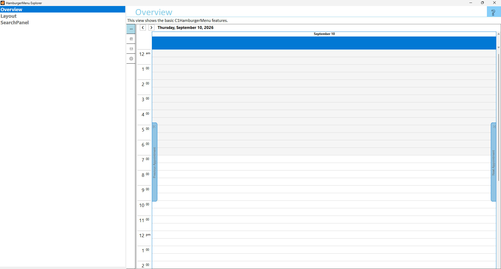

## HamburgerMenuExplorer
#### [Download as zip](https://grapecity.github.io/DownGit/#/home?url=https://github.com/GrapeCity/ComponentOne-WinForms-Samples/tree/master/Core\HamburgerMenu\CS\HamburgerMenuExplorer)
____
#### Shows all the features of HamburgerMenu control.
____
HamburgerMenuExplorer is the single source for you to learn about HamburgerMenu. 
It shows all the features of HamburgerMenu in an easy to explore hierarchy.

Included samples:

* Overview.
  This view shows the basic C1HamburgerMenu features.

* Layout.
  This view shows different Layout options for C1HamburgerMenu control.

* SearchPanel.
  This view shows the basic C1HamburgerMenuSearchPanel features.

