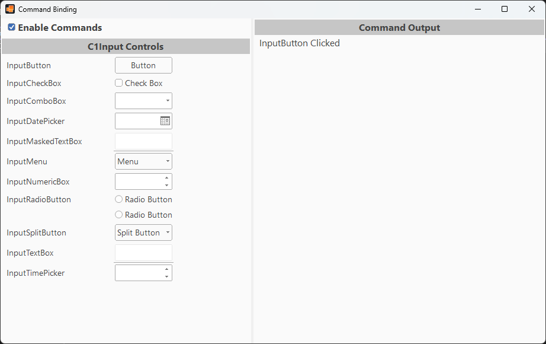

## CommandBinding
#### [Download as zip](https://grapecity.github.io/DownGit/#/home?url=https://github.com/GrapeCity/ComponentOne-WinForms-Samples/tree/master/NetFramework\InputPanel\VB\CommandBinding)
____
#### Binds commands to the InputPanel components.
____
This demo shows how a single ICommand can be shared across all C1InputPanel items.
Interact with any component to see it fire the command.

