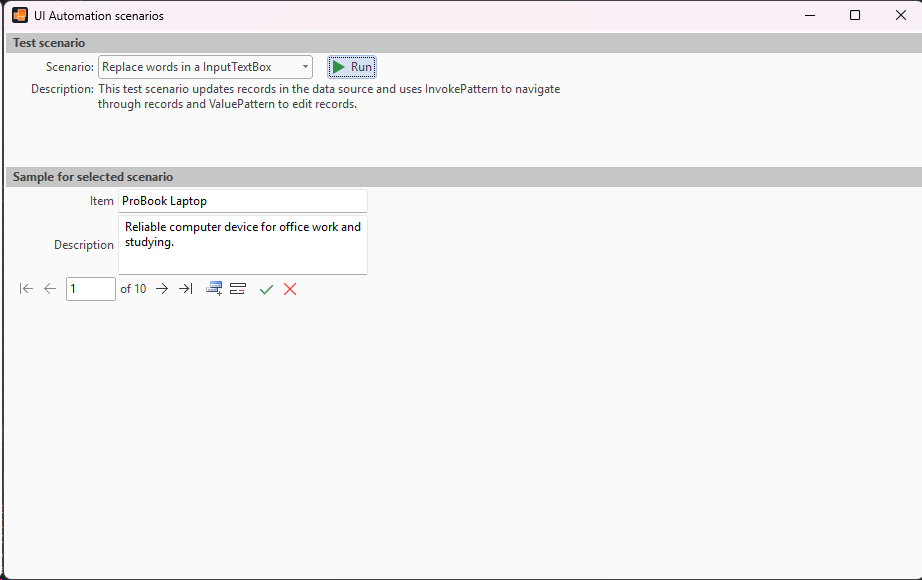

## UIAScenarios
#### [Download as zip](https://grapecity.github.io/DownGit/#/home?url=https://github.com/GrapeCity/ComponentOne-WinForms-Samples/tree/master/NetFramework\InputPanel\VB\UIAScenarios)
____
#### Fills the InputPanel with items and emulates user interaction with UI using the UIA API.
____
The user can run several scenarios demonstrating how UI automation interacts with InputPanel items.
The sample uses various UIA patterns to interact with InputPanel items.

